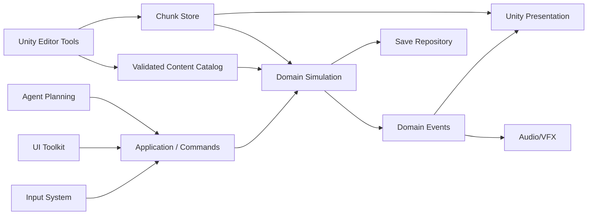

# Arquitetura — Unity offline, processo único

Status: proposta inicial  
Target: Unity 6.6 (6000.6.7f1), Windows x64 primeiro  
Fonte das regras: [especificação](../spec/especificacao.md) (sala limpa; alinhamento de 2026-11-02 no Anexo A dela)

## 1. Decisões executivas

1. A simulação local é a autoridade; não haverá servidor local oculto nem sockets no primeiro produto.
2. O domínio será C# puro e não conhecerá `GameObject`, `MonoBehaviour`, Scene ou UI.
3. Unity apresenta o estado; não é a fonte de verdade do estado persistente.
4. Definições autorais usam ScriptableObjects no Editor e um catálogo validado no build.
5. Estado mutável usa DTOs versionados e snapshots atômicos; ScriptableObject não é save runtime.
6. A simulação usa tick fixo, contado em inteiros, e RNG injetável/determinístico com estado salvo (seções 9 e 12).
7. Mundo, render e agentes usam LOD. Nenhum facet grande vira milhões de GameObjects.
8. Multiplayer futuro só poderá entrar por uma nova implementação de autoridade; não será antecipado com dependências de netcode.
9. DOTS/Entities não é obrigatório no início. Só será adotado após profiling demonstrar um gargalo que o modelo híbrido não resolve.
10. Todo conteúdo passa por um provedor de recursos com duas implementações: conteúdo próprio (padrão) e leitor da instalação do jogador (opcional, desligado por padrão, só em tempo de execução e só para uso pessoal). Não há importador nem cache em disco; nada lido da instalação vai para `Assets/`, git, build, save ou capturas versionadas (especificação §3.0 e §17).
11. Uma origem por mundo: a configuração escolhe "próprio" ou "instalação" para mapa e arte; o recurso que faltar na instalação cai no conteúdo próprio (especificação §3.0, regra 2).

A versão é o Unity 6.6 (6000.6.7f1), decisão do responsável em 2026-10-28. A 6.6 é "supported release", não LTS: recebe correções até sair a 6.7 LTS, prevista para o quarto trimestre de 2026 ([anúncio da Unity](https://discussions.unity.com/t/unity-6-6-is-now-available/1735357)); a migração para a 6.7 LTS entra no roadmap. O [ScriptableObject](https://docs.unity3d.com/6000.1/Documentation/Manual/class-ScriptableObject.html) é apropriado para dados compartilhados de autoria, mas a própria documentação ressalta que ele não deve ser usado para salvar alterações em um build publicado.

## 2. Visão de componentes



### Fluxo de uma ação

1. Input/UI cria um comando semântico, por exemplo `UseItem(itemId, targetId)`.
2. Application valida contexto básico e entrega o comando à simulação.
3. Domain avalia regras, altera estado e emite eventos.
4. Presentation anima o resultado; UI atualiza por view models.
5. Save captura somente estado autoritativo, nunca transforms visuais transitórios.

## 3. Camadas

### Domain

C# sem dependência de Unity:

- entity IDs e value objects;
- stats, skills, effects e cooldowns;
- items, containers, equipment e ownership;
- combat, spells, crafting e harvesting;
- economy, reputation, crime e factions;
- AI state, schedules e memory;
- world coordinates, regions e queries de walkability;
- domain events e rule profiles.

### Application

- command bus local;
- orchestration de use cases;
- tick scheduler;
- save/load e migrations;
- streaming coordinator;
- serviços de pathfinding e simulação distante;
- adapters para input, UI e tooling.

### Infrastructure

- filesystem e escrita atômica;
- serializers e compressão;
- content catalog loader;
- chunk database;
- logs e diagnostics;
- provedor de recursos: origem própria e leitor opcional da instalação (só em tempo de execução, sem conversão nem cache em disco).

### Presentation.Unity

- cameras, sprites/meshes, animation e pooling;
- view lifecycle por chunk;
- efeitos, áudio e feedback;
- UI Toolkit e view models;
- bridge de Input System para commands.

### Editor

- authoring de tiles, chunks, regions e portals;
- item/skill/recipe/loot/spell editors;
- spawn e schedule editors;
- validators, previews e simuladores.

## 4. Estrutura proposta

```text
PRKing_UO/
├── docs/
├── tools/                          # sem importadores: a instalação só é lida em tempo de execução
└── Unity/
    ├── Assets/
    │   └── _Project/
    │       ├── Art/
    │       ├── Audio/
    │       ├── Content/
    │       │   ├── Classic/            # regras e conteúdo próprios do perfil T2A; nada da instalação
    │       │   ├── Custom/
    │       │   └── Shared/
    │       ├── Scenes/
    │       │   ├── Bootstrap.unity
    │       │   ├── MainMenu.unity
    │       │   ├── Sandbox.unity           # cena de testes que cresce por fase
    │       │   └── Game.unity
    │       ├── Scripts/
    │       │   ├── Domain/
    │       │   ├── Application/
    │       │   ├── Infrastructure/
    │       │   ├── Presentation/
    │       │   └── Editor/
    │       ├── Tests/
    │       │   ├── EditMode/
    │       │   └── PlayMode/
    │       └── UI/
    ├── Packages/
    └── ProjectSettings/
```

## 5. Assembly definitions

| Assembly | Referências permitidas | Observação |
|---|---|---|
| `PRKing.Domain` | BCL apenas | núcleo determinístico |
| `PRKing.Application` | Domain | comandos e orchestration |
| `PRKing.Infrastructure` | Domain, Application, Unity quando necessário | IO e adapters |
| `PRKing.Presentation` | Domain, Application, Unity | views e runtime UI |
| `PRKing.Editor` | todos + UnityEditor | nunca entra no player |
| `PRKing.Tests.EditMode` | Domain, Application, Infrastructure | maioria dos testes |
| `PRKing.Tests.PlayMode` | Presentation | integração visual mínima |

Regra: Domain e Application não podem referenciar namespaces `UnityEngine` ou `UnityEditor`.

## 6. Stack Unity

- Unity 6.6 (6000.6.7f1), fixado nesse patch até a migração para a 6.7 LTS.
- URP 2D ou renderer customizado leve para a apresentação isométrica.
- Input System para teclado, mouse e gamepad remapeáveis.
- UI Toolkit para HUD, containers, paperdoll, journal e ferramentas de layout.
- Addressables locais para packs de conteúdo e streaming de assets; nenhum remote catalog no build offline.
- Unity Test Framework para EditMode e PlayMode.
- NUnit/fakes no domínio.

Unity documenta [Isometric Tilemaps](https://docs.unity3d.com/Manual/Tilemap-Isometric.html), incluindo Z-as-Y e sorting. Eles servem para protótipo e autoria; o facet final poderá usar um renderer por chunks se Tilemap não atingir os budgets. [Addressables](https://docs.unity.cn/Packages/com.unity.addressables%403.0/manual/AddressableAssetSettings.html) será configurado apenas com load paths locais.

## 7. Modelo de dados

### Definições imutáveis

```text
ContentId
ItemDefinition
SkillDefinition
SpellDefinition
RecipeDefinition
CreatureDefinition
LootTableDefinition
NpcArchetypeDefinition
QuestDefinition
RegionDefinition
RuleProfileDefinition
```

Campos comuns: `id`, `schemaVersion`, `displayNameKey`, `introducedInEra`, `tags`, `enabledProfiles` e referências por `ContentId`.

`ContentId` é próprio e neutro. Uma tabela de correspondência liga cada ID ao asset próprio e, quando existir, ao gráfico da instalação; regras, dados e save usam só IDs próprios, e trocar a origem não quebra o save (especificação §3.0, regra 1). `RuleProfileDefinition` guarda os números das regras como dados, com os perfis "T2A estrito" e "pré-AOS final" e o ponto de referência de março de 2000 (D1).

### Estado mutável

```text
WorldState
EntityState
CharacterState
ItemInstanceState
ContainerState
AgentState
EconomyState
QuestState
RegionRuntimeState
ClockState
```

Definição e instância nunca se confundem. Uma espada pode referenciar `item.sword.long`, mas sua durabilidade, qualidade, crafter e propriedades pertencem à instância.

## 8. Mundo e streaming

### Coordenadas

- `WorldTile(x, y, z, worldId)` é a coordenada autoritativa.
- Presentation converte tile para posição isométrica.
- Altura usa inteiro discreto; floats ficam restritos à interpolação visual.
- Projeção e medidas comuns às duas origens: losango de 44 × 44 pixels e 4 pixels por unidade de altura (especificação §3.0 e §3.9).

### Chunks

- tamanho inicial: 32×32 tiles, ajustável após profiling, sempre múltiplo de 8. Com a origem "instalação", cada chunk junta 4 × 4 blocos nativos de 8 × 8, lidos na ordem de coluna, com células em ordem de linha (especificação §3.5);
- a ativação da IA usa setores de 16 × 16 tiles por proximidade do jogador, independentes do tamanho do chunk (especificação §2 e §13.1);
- arquivos independentes para terrain, statics, navigation e metadata (origem própria; com a origem "instalação", os chunks são montados em memória a partir dos arquivos dela, sem gravar nada em disco);
- working set com anéis: visible, simulated-near, simulated-far e dormant;
- cache LRU com prefetch na direção do movimento;
- carregamento assíncrono e commit no início de tick.

### Render

- ordem de desenho da especificação §3.9: entre células, diagonais de x + y crescente; dentro da célula, prioridade por altura e tipo (terreno, objeto de fundo, objeto, personagem, efeito); `stableId` só desempata. Uma chave por `screenY` mistura altura e erra objetos altos;
- **a ordem vem antes do batching** (revisão técnica, R03): o chunk de armazenamento não é a unidade de renderização. Só o terreno e o que nunca fica na frente de um personagem podem ser agrupados por chunk ou por atlas/material; objetos que podem cobrir personagens (paredes, árvores, statics altos, pilhas) são desenhados intercalados com eles, também entre chunks vizinhos. O modo Chunk do Tilemap Renderer não intercala objetos entre profundidades; o modo Individual intercala, com custo ([Unity: Tilemap Renderer](https://docs.unity.com/en-us/engine/6000.0/manual/unity2d/tilemaps/reference/tilemap-renderer)). A escolha entre Individual, SRP Batcher e renderer próprio sai de medição, depois que a galeria de desenho passa nos casos visuais;
- picking escolhe o objeto desenhado por último sob o cursor, na mesma ordem do desenho;
- pooling para mobiles, doors, effects e labels;
- occlusion/fade para telhados e paredes, com o teto calculado a partir da célula do jogador (especificação §3.9);
- número de renderers limitado por chunk, nunca um por tile, desde que a ordem acima continue certa.

Os nomes ficam separados: bloco de leitura (8 × 8, origem "instalação"), chunk de armazenamento (32 × 32), setor de ativação da IA (16 × 16) e grupo de renderização. Os tamanhos podem diferir.

## 9. Simulação e tempo

- passo autoritativo de 25 ms (40 Hz) para timers de ação e de IA (decisão do responsável em 2026-11-02, especificação, Anexo A, A18): os tempos fixos de passo, conjuração e ritmo de IA (§2.2, §7.2 e §13.1) caem em múltiplos de 25 ms. A fórmula do intervalo de golpe (§6.1) continua contínua; o resultado é agendado no passo mais próximo, com erro de até 12,5 ms. Os números continuam em dados;
- sistemas pesados rodam em fatias de 10 Hz (a cada 4 passos), como nos níveis de detalhe da seção 10;
- timers guardados como tempo restante, para que salvar e carregar preserve o estado (especificação §2.1);
- apresentação interpolada até o frame rate;
- ações usam tempo de simulação, não `Time.deltaTime` diretamente;
- relógio de mundo desacoplado do wall clock;
- pause congela simulação, mas não UI;
- speed 1×/2× opcional somente depois de testes de combat/crafting;
- no build de desenvolvimento, o relógio aceita pausar, avançar um passo e avançar N minutos rodando os passos sem desenhar; é assim que o [sandbox de testes](sandbox-de-testes.md) testa corpos, reposição e dia e noite sem esperar.

Cada tick processa uma fila limitada. Sistemas pesados — path requests, economia global, planejamento distante — são distribuídos em slots para evitar spikes.

### Política do scheduler (revisão técnica, R04)

- **Tempo em ticks inteiros.** O tempo autoritativo é um contador inteiro de passos de 25 ms; timers, relógio do mundo e journal usam esse contador. Float só na interpolação visual. `Time.timeScale` não comanda o relógio autoritativo.
- **Acumulador no adapter Unity.** O adapter soma o tempo real do frame e executa os passos devidos, até um **máximo de passos por frame** (valor em configuração; ponto de partida a confirmar no Profiler: 8 passos, 200 ms).
- **Atraso não descarta passos.** Se o atraso passar do máximo, a simulação desacelera e fica atrás do tempo real; o excesso acumulado acima de um teto também configurável é abandonado como tempo real perdido, nunca como passos pulados. Nenhum evento vencido é saltado: todo passo executado roda inteiro. O mesmo vale para a volta de uma pausa ou da perda de foco: não há rajada de passos.
- **Input na fronteira do tick.** Input e UI viram comandos que entram na fila e são aplicados no início do próximo passo, com o número desse passo.
- **40 Hz é resolução, não obrigação.** Cada agente roda quando o prazo dele vence; ninguém recalcula toda a IA a cada passo.
- **Avanço de N minutos em lotes.** Dez minutos são 24.000 passos. O avanço roda em lotes por frame, com progresso, e pode ser cancelado entre lotes; cancelar deixa o mundo num passo inteiro, nunca no meio de um.
- **Mesmo resultado em qualquer taxa de quadros.** A mesma sequência de comandos com apresentação a 30, 60 ou 144 FPS, ou com frames lentos de 100 e 250 ms injetados, termina no mesmo estado (seção 14).

### Sessão e ciclo de vida (revisão técnica, R05)

A Unity 6.6 entra em Play Mode recarregando só a cena, sem domain reload, por padrão em projetos novos ([Unity 6.6: Enter Play Mode configurável](https://docs.unity.com/en-us/engine/6000.6/manual/programming-environment/code-reload-serialization/code-reload/code-reloading-editor/configurable-enter-play-mode)). Estado estático sobrevive de uma execução para a outra e pode parecer falha de determinismo. Regras:

- um objeto de sessão (`GameSession`) é dono do relógio, do RNG, das filas, do mundo e do journal, com início e descarte explícitos; o Bootstrap cria a sessão e liga os adapters concretos;
- Domain e Application não têm estado estático mutável; o estático inevitável nos adapters é limpo no ciclo de vida que a Unity documenta para o caso sem domain reload ([Unity 6.6: domain reloading](https://docs.unity.com/en-us/engine/6000.6/manual/programming-environment/code-reload-serialization/code-reload/code-reloading-editor/domain-reloading));
- toda inscrição em evento tem dono e é desfeita no descarte da sessão;
- ScriptableObjects de autoria nunca são alterados em execução: a sessão trabalha com cópias de dados;
- tarefas assíncronas pertencem a uma sessão; resultado de sessão antiga é descartado e não povoa a nova;
- reset e descarte podem ser chamados mais de uma vez sem efeito extra.

## 10. AI e população

Na primeira versão, as criaturas usam os arquétipos corpo a corpo e animal da especificação §13.1 (percepção, fuga, território e ritmo em dados). O modelo híbrido abaixo é para a Fase 5.

### Modelo híbrido

- Utility AI escolhe necessidades e objetivos.
- State machine/behavior tree executa a ação atual.
- Planner simples encadeia tarefas econômicas: obter minério → usar forge → vender espada.
- memória episódica curta alimenta diálogo e reputação.

### Níveis de detalhe

| Nível | Estado | Frequência | Exemplo |
|---|---|---:|---|
| L0 | visível | passo de 25 ms (ações e IA); fatias de 10 Hz (sistemas pesados) | combate, portas, animação, colisão |
| L1 | região próxima | 1–2 Hz | viagem, trabalho, busca local |
| L2 | distante | a cada 5–30 s | transações e deslocamento abstrato |
| L3 | dormente | por evento/agenda | dormir, estoque estacionário |

Agentes distantes não percorrem cada tile. Eles avançam por arestas de grafo com duração e riscos calculados, materializando-se em arrival points válidos.

### Navegação

- A* local no grid com altura, doors e capabilities;
- grafo regional para estradas, gates e dungeons;
- arrival points separados do centro semântico do destino;
- path validator de Editor;
- telemetria local de stuck e repath;
- recuperação escalonada: abrir porta → sidestep → repath → nearest safe node.

## 11. Economia

Na primeira versão, o vendedor usa o modelo de tabela da especificação §11.3: preço-base com a taxa da cidade, preço pago ao jogador por tipo e qualidade, revenda e reposição por hora de jogo. O modelo abaixo entra na Fase 4 como perfil próprio, sem trocar as regras do perfil T2A.

Modelo de ledger fechado por transação:

- faucets: loot, contratos, quests e produção primária;
- sinks: vendors, treinamento, reparo, housing, reagentes, taxas e deterioração;
- estoques de vendors são inventários reais ou agregados auditáveis;
- agentes consomem comida, reagentes, munição, ferramentas e equipamentos;
- preços usam faixa-base + estoque + demanda + reputação, com amortecimento;
- simulador headless executa dias virtuais e produz métricas de inflação, escassez e concentração.

O sistema não tenta recriar a ecologia fechada original de UO. Ele usa controladores observáveis para garantir reposição e evitar colapso, incorporando a lição histórica do [faucet-drain economy](https://www.raphkoster.com/games/snippets/did-players-destroy-the-uo-ecology/).

## 12. Save e migrations

Estrutura:

```text
Saves/<slot>/
├── manifest.json
├── snapshot-000042.bin
├── snapshot-000041.bin.backup
├── journal-000042.log
└── screenshot.png
```

Regras:

- escrever em arquivo temporário, flush, checksum e rename atômico;
- manter pelo menos um snapshot anterior íntegro;
- `schemaVersion` global e por agregado;
- migrations forward-only testadas com fixtures antigas;
- autosave por tempo e em transições seguras;
- save manual nunca sobrescreve o único backup válido;
- carregar falha com mensagem e opção de backup, não com mundo parcial;
- o journal guarda os comandos aceitos desde o último snapshot; snapshot + journal reexecutam a sessão de forma determinística, o que serve para recuperar o save e para reproduzir defeitos;
- o save guarda o estado autoritativo (entidades, timers com tempo restante, relógio do mundo, **estado atual do gerador de sorteio**) e só IDs próprios; nada lido da instalação vai para o save, inclusive `screenshot.png`, que só é gravado com a origem "próprio" (especificação §3.0 e §15).

### Determinismo e replay (revisão técnica, R01)

- **Estado do RNG, não só a semente.** Recomeçar pela semente depois de um load repete o início da sequência. O snapshot guarda o estado interno do gerador, e o load continua dali.
- **Gerador próprio, com versão.** As regras usam um algoritmo de RNG próprio, com número de versão gravado no save. `System.Random` não entra nas regras: a Microsoft não garante a mesma sequência entre versões do .NET ([Microsoft: System.Random](https://learn.microsoft.com/en-us/dotnet/api/system.random?view=net-10.0#notes-to-callers)). O RNG visual (partículas, variações de animação) é outro gerador e não consome do RNG das regras.
- **Journal com tick e sequência.** Cada entrada guarda o passo em que o comando é executado, um número de sequência crescente e os parâmetros em forma canônica. Comandos do jogador e de depuração entram uma vez; decisões da IA não entram, porque o replay as regenera. O journal registra também o passo final, mesmo sem comandos novos.
- **Ordem estável.** Entidades são processadas em ordem de ID, e empates entre eventos do mesmo passo têm desempate fixo. Conclusão de tarefa assíncrona (carga de chunk, por exemplo) nunca decide regra.
- **Versão da simulação.** O snapshot grava `simulationVersion` e o hash do perfil de regras e do catálogo próprio. O replay só vale na mesma versão; entre versões, o load migra o snapshot ou recusa o replay com mensagem.
- **Teste de aceite:** execução contínua, execução salva e carregada no meio e replay do journal terminam no mesmo estado e produzem as mesmas próximas rolagens.

### Captura e publicação do save (revisão técnica, R02)

- **Captura numa fronteira de tick.** O snapshot é uma cópia em DTO tirada entre dois passos, nunca no meio de um. Assim não há item no chão e na mochila ao mesmo tempo, nem ouro debitado sem mercadoria entregue. A serialização, a compressão e a escrita podem rodar em segundo plano sobre essa cópia.
- **Geração completa antes do ponteiro.** Snapshot e journal de uma geração são escritos e conferidos primeiro; o `manifest.json` é trocado por último e só aponta para uma geração completa. O manifest guarda o último número de sequência do journal incluído no snapshot.
- **Saves em fila.** Pedidos de save entram numa fila; um save antigo nunca termina por cima de um mais novo.
- **Pasta.** Os saves ficam em `Application.persistentDataPath`, fora de `Assets/`, do repositório e da pasta do build, com empresa e produto estáveis ([Unity: persistentDataPath](https://docs.unity3d.com/6000.0/ScriptReference/Application-persistentDataPath.html)).
- **Medição.** O Profiler mede separado o tempo de captura dentro do frame e a duração total do save.

## 13. UI

- UI escalável independente da câmera;
- UXML/USS para estrutura e temas;
- drag/drop em containers com command semântico;
- target mode explícito e cancelável;
- tooltips gerados por dados, sem texto hardcoded;
- journal com filtros para sistema, fala, combate e loot;
- hotbar e bindings persistentes;
- paperdoll, status, skills e inventário podem ser desacoplados e reposicionados;
- perfis de escala e fonte para 720p, 1080p e 4K.

## 14. Testes e gates

### EditMode

- caps e skill gain;
- transferência e invariantes de containers;
- fórmulas de combate por profile;
- crafting e consumo atômico de ingredientes;
- economy ledger;
- pathfinding e arrival points;
- serialization, checksum e migrations;
- determinismo: contínuo, salvo e carregado no meio, e replay dão o mesmo estado e as mesmas próximas rolagens (seção 12);
- scheduler: frames lentos de 100 e 250 ms injetados e apresentação a 30, 60 e 144 FPS dão o mesmo estado; pausa, retomada e cancelamento do avanço de tempo (seção 9);
- save com falhas injetadas na captura, na escrita, na troca e na publicação; journal parcial; dois saves seguidos;
- roteiros das estações do [sandbox](sandbox-de-testes.md) rodando só no domínio, sem cena.

Testes com dados da instalação são só locais: pulados quando a instalação não existe, nunca viram fixture versionada nem rodam na integração contínua (especificação §3.0, regra 6).

### PlayMode

- bootstrap e troca de scenes;
- dez entradas seguidas em Play Mode no mesmo Editor, com domain reload ligado e desligado: uma reação por comando, nenhuma entidade ou inscrição de sessão anterior (seção 9);
- world streaming sem duplicar entidades;
- drag/drop e targeting;
- render sorting nas bordas de chunk (personagem à frente e atrás de árvore, parede e pilha) e roof fade;
- save/load end-to-end;
- roteiros das estações do sandbox com apresentação;
- input remapping.

### Gates

- zero erros e warnings novos no Console;
- todos os EditMode/PlayMode tests passam;
- content validator sem referências quebradas;
- build Windows x64 executa offline;
- profiler dentro dos budgets do milestone.

## 15. Segurança de conteúdo e licenças

- `Assets/_Project` aceita apenas conteúdo próprio ou com licença registrada.
- cada pack possui `THIRD_PARTY_NOTICES.md` quando necessário.
- não há importador: o leitor da instalação roda só em tempo de execução, desligado por padrão e só para uso pessoal; nada lido dela entra em `Assets/`, git, build, save ou capturas versionadas.
- nenhum build contém nomes, mapas, arte, áudio ou texto da EA; nenhum build é distribuído por ora, e um build compartilhado no futuro usa só conteúdo próprio (especificação §17).
- o produto se chama Outrora; nenhuma marca da EA no produto, no repositório ou em divulgação.
- sala limpa: o código de clientes e emuladores de código aberto (ClassicUO, RunUO, ModernUO, ServUO, MobileUO, UO Offline e outros) não é aberto ao escrever o código do projeto, e nada dele é copiado; a única fonte de regras e formatos é a especificação.
- o `.gitignore` bloqueia os formatos de dados do jogo de referência.

## 16. Seam para multiplayer futuro

Não implementar netcode agora. Manter apenas:

```text
ICommandSink.Submit(command)
IWorldSnapshotSource.GetSnapshot()
IClock
IRandomSource
IEntityIdGenerator
```

Hoje, todos são locais. Um futuro modo online poderia substituir command sink e snapshot source, mas isso não deve distorcer o design do jogo offline nem introduzir serialização de rede prematuramente.

