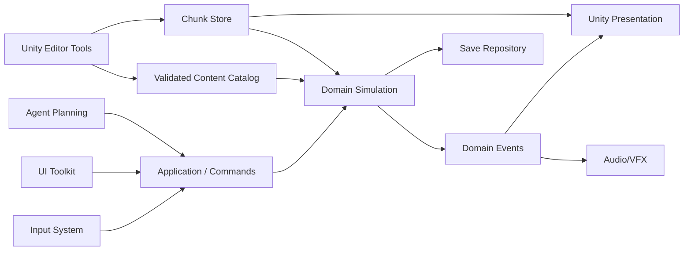

# Arquitetura — Unity offline, processo único

Status: proposta inicial  
Target: Unity 6.6 (6000.6.7f1), Windows x64 primeiro

## 1. Decisões executivas

1. A simulação local é a autoridade; não haverá servidor local oculto nem sockets no primeiro produto.
2. O domínio será C# puro e não conhecerá `GameObject`, `MonoBehaviour`, Scene ou UI.
3. Unity apresenta o estado; não é a fonte de verdade do estado persistente.
4. Definições autorais usam ScriptableObjects no Editor e um catálogo validado no build.
5. Estado mutável usa DTOs versionados e snapshots atômicos; ScriptableObject não é save runtime.
6. A simulação usa tick fixo e RNG injetável/determinístico.
7. Mundo, render e agentes usam LOD. Nenhum facet grande vira milhões de GameObjects.
8. Multiplayer futuro só poderá entrar por uma nova implementação de autoridade; não será antecipado com dependências de netcode.
9. DOTS/Entities não é obrigatório no início. Só será adotado após profiling demonstrar um gargalo que o modelo híbrido não resolve.

A versão é o Unity 6.6 (6000.6.7f1), decisão do responsável em 2026-10-28. A 6.6 é "supported release", não LTS: recebe correções até sair a 6.7 LTS, prevista para o quarto trimestre de 2026 ([anúncio da Unity](https://discussions.unity.com/t/unity-6-6-is-now-available/1735357)); a migração para a 6.7 LTS entra no roadmap. O [ScriptableObject](https://docs.unity3d.com/6000.1/Documentation/Manual/class-ScriptableObject.html) é apropriado para dados compartilhados de autoria, mas a própria documentação ressalta que ele não deve ser usado para salvar alterações em um build publicado.

## 2. Visão de componentes



### Fluxo de uma ação

1. Input/UI cria um comando semântico, por exemplo `UseItem(itemId, targetId)`.
2. Application valida contexto básico e entrega o comando à simulação.
3. Domain avalia regras, altera estado e emite eventos.
4. Presentation anima o resultado; UI atualiza por view models.
5. Save captura somente estado autoritativo, nunca transforms visuais transitórios.

## 3. Camadas

### Domain

C# sem dependência de Unity:

- entity IDs e value objects;
- stats, skills, effects e cooldowns;
- items, containers, equipment e ownership;
- combat, spells, crafting e harvesting;
- economy, reputation, crime e factions;
- AI state, schedules e memory;
- world coordinates, regions e queries de walkability;
- domain events e rule profiles.

### Application

- command bus local;
- orchestration de use cases;
- tick scheduler;
- save/load e migrations;
- streaming coordinator;
- serviços de pathfinding e simulação distante;
- adapters para input, UI e tooling.

### Infrastructure

- filesystem e escrita atômica;
- serializers e compressão;
- content catalog loader;
- chunk database;
- logs e diagnostics;
- importadores opcionais isolados.

### Presentation.Unity

- cameras, sprites/meshes, animation e pooling;
- view lifecycle por chunk;
- efeitos, áudio e feedback;
- UI Toolkit e view models;
- bridge de Input System para commands.

### Editor

- authoring de tiles, chunks, regions e portals;
- item/skill/recipe/loot/spell editors;
- spawn e schedule editors;
- validators, previews e simuladores.

## 4. Estrutura proposta

```text
PRKing_UO/
├── docs/
├── tools/
│   └── importers/                  # ferramentas externas opcionais
└── Unity/
    ├── Assets/
    │   └── _Project/
    │       ├── Art/
    │       ├── Audio/
    │       ├── Content/
    │       │   ├── Classic/
    │       │   ├── Custom/
    │       │   └── Shared/
    │       ├── Scenes/
    │       │   ├── Bootstrap.unity
    │       │   ├── MainMenu.unity
    │       │   └── Game.unity
    │       ├── Scripts/
    │       │   ├── Domain/
    │       │   ├── Application/
    │       │   ├── Infrastructure/
    │       │   ├── Presentation/
    │       │   └── Editor/
    │       ├── Tests/
    │       │   ├── EditMode/
    │       │   └── PlayMode/
    │       └── UI/
    ├── Packages/
    └── ProjectSettings/
```

## 5. Assembly definitions

| Assembly | Referências permitidas | Observação |
|---|---|---|
| `PRKing.Domain` | BCL apenas | núcleo determinístico |
| `PRKing.Application` | Domain | comandos e orchestration |
| `PRKing.Infrastructure` | Domain, Application, Unity quando necessário | IO e adapters |
| `PRKing.Presentation` | Domain, Application, Unity | views e runtime UI |
| `PRKing.Editor` | todos + UnityEditor | nunca entra no player |
| `PRKing.Tests.EditMode` | Domain, Application, Infrastructure | maioria dos testes |
| `PRKing.Tests.PlayMode` | Presentation | integração visual mínima |

Regra: Domain e Application não podem referenciar namespaces `UnityEngine` ou `UnityEditor`.

## 6. Stack Unity

- Unity 6.6 (6000.6.7f1), fixado nesse patch até a migração para a 6.7 LTS.
- URP 2D ou renderer customizado leve para a apresentação isométrica.
- Input System para teclado, mouse e gamepad remapeáveis.
- UI Toolkit para HUD, containers, paperdoll, journal e ferramentas de layout.
- Addressables locais para packs de conteúdo e streaming de assets; nenhum remote catalog no build offline.
- Unity Test Framework para EditMode e PlayMode.
- NUnit/fakes no domínio.

Unity documenta [Isometric Tilemaps](https://docs.unity3d.com/Manual/Tilemap-Isometric.html), incluindo Z-as-Y e sorting. Eles servem para protótipo e autoria; o facet final poderá usar um renderer por chunks se Tilemap não atingir os budgets. [Addressables](https://docs.unity.cn/Packages/com.unity.addressables%403.0/manual/AddressableAssetSettings.html) será configurado apenas com load paths locais.

## 7. Modelo de dados

### Definições imutáveis

```text
ContentId
ItemDefinition
SkillDefinition
SpellDefinition
RecipeDefinition
CreatureDefinition
LootTableDefinition
NpcArchetypeDefinition
QuestDefinition
RegionDefinition
RuleProfileDefinition
```

Campos comuns: `id`, `schemaVersion`, `displayNameKey`, `introducedInEra`, `tags`, `enabledProfiles` e referências por `ContentId`.

### Estado mutável

```text
WorldState
EntityState
CharacterState
ItemInstanceState
ContainerState
AgentState
EconomyState
QuestState
RegionRuntimeState
ClockState
```

Definição e instância nunca se confundem. Uma espada pode referenciar `item.sword.long`, mas sua durabilidade, qualidade, crafter e propriedades pertencem à instância.

## 8. Mundo e streaming

### Coordenadas

- `WorldTile(x, y, z, worldId)` é a coordenada autoritativa.
- Presentation converte tile para posição isométrica.
- Altura usa inteiro discreto; floats ficam restritos à interpolação visual.

### Chunks

- tamanho inicial: 32×32 tiles, ajustável após profiling;
- arquivos independentes para terrain, statics, navigation e metadata;
- working set com anéis: visible, simulated-near, simulated-far e dormant;
- cache LRU com prefetch na direção do movimento;
- carregamento assíncrono e commit no início de tick.

### Render

- terreno e statics batchados por atlas/material;
- sorting por chave `(screenY, z, layer, stableId)`;
- pooling para mobiles, doors, effects e labels;
- occlusion/fade para telhados e paredes;
- no máximo um número limitado de renderers por chunk, nunca por tile.

## 9. Simulação e tempo

- tick autoritativo inicial: 10 Hz;
- apresentação interpolada até o frame rate;
- ações usam tempo de simulação, não `Time.deltaTime` diretamente;
- relógio de mundo desacoplado do wall clock;
- pause congela simulação, mas não UI;
- speed 1×/2× opcional somente depois de testes de combat/crafting.

Cada tick processa uma fila limitada. Sistemas pesados — path requests, economia global, planejamento distante — são distribuídos em slots para evitar spikes.

## 10. AI e população

### Modelo híbrido

- Utility AI escolhe necessidades e objetivos.
- State machine/behavior tree executa a ação atual.
- Planner simples encadeia tarefas econômicas: obter minério → usar forge → vender espada.
- memória episódica curta alimenta diálogo e reputação.

### Níveis de detalhe

| Nível | Estado | Frequência | Exemplo |
|---|---|---:|---|
| L0 | visível | 10 Hz | combate, portas, animação, colisão |
| L1 | região próxima | 1–2 Hz | viagem, trabalho, busca local |
| L2 | distante | a cada 5–30 s | transações e deslocamento abstrato |
| L3 | dormente | por evento/agenda | dormir, estoque estacionário |

Agentes distantes não percorrem cada tile. Eles avançam por arestas de grafo com duração e riscos calculados, materializando-se em arrival points válidos.

### Navegação

- A* local no grid com altura, doors e capabilities;
- grafo regional para estradas, gates e dungeons;
- arrival points separados do centro semântico do destino;
- path validator de Editor;
- telemetria local de stuck e repath;
- recuperação escalonada: abrir porta → sidestep → repath → nearest safe node.

## 11. Economia

Modelo de ledger fechado por transação:

- faucets: loot, contratos, quests e produção primária;
- sinks: vendors, treinamento, reparo, housing, reagentes, taxas e deterioração;
- estoques de vendors são inventários reais ou agregados auditáveis;
- agentes consomem comida, reagentes, munição, ferramentas e equipamentos;
- preços usam faixa-base + estoque + demanda + reputação, com amortecimento;
- simulador headless executa dias virtuais e produz métricas de inflação, escassez e concentração.

O sistema não tenta recriar a ecologia fechada original de UO. Ele usa controladores observáveis para garantir reposição e evitar colapso, incorporando a lição histórica do [faucet-drain economy](https://www.raphkoster.com/games/snippets/did-players-destroy-the-uo-ecology/).

## 12. Save e migrations

Estrutura:

```text
Saves/<slot>/
├── manifest.json
├── snapshot-000042.bin
├── snapshot-000041.bin.backup
├── journal-000042.log
└── screenshot.png
```

Regras:

- escrever em arquivo temporário, flush, checksum e rename atômico;
- manter pelo menos um snapshot anterior íntegro;
- `schemaVersion` global e por agregado;
- migrations forward-only testadas com fixtures antigas;
- autosave por tempo e em transições seguras;
- save manual nunca sobrescreve o único backup válido;
- carregar falha com mensagem e opção de backup, não com mundo parcial.

## 13. UI

- UI escalável independente da câmera;
- UXML/USS para estrutura e temas;
- drag/drop em containers com command semântico;
- target mode explícito e cancelável;
- tooltips gerados por dados, sem texto hardcoded;
- journal com filtros para sistema, fala, combate e loot;
- hotbar e bindings persistentes;
- paperdoll, status, skills e inventário podem ser desacoplados e reposicionados;
- perfis de escala e fonte para 720p, 1080p e 4K.

## 14. Testes e gates

### EditMode

- caps e skill gain;
- transferência e invariantes de containers;
- fórmulas de combate por profile;
- crafting e consumo atômico de ingredientes;
- economy ledger;
- pathfinding e arrival points;
- serialization, checksum e migrations;
- determinismo com seed.

### PlayMode

- bootstrap e troca de scenes;
- world streaming sem duplicar entidades;
- drag/drop e targeting;
- render sorting e roof fade;
- save/load end-to-end;
- input remapping.

### Gates

- zero erros e warnings novos no Console;
- todos os EditMode/PlayMode tests passam;
- content validator sem referências quebradas;
- build Windows x64 executa offline;
- profiler dentro dos budgets do milestone.

## 15. Segurança de conteúdo e licenças

- `Assets/_Project` aceita apenas conteúdo próprio ou com licença registrada.
- cada pack possui `THIRD_PARTY_NOTICES.md` quando necessário.
- importadores de dados externos ficam fora do runtime e do conteúdo versionado.
- o build público não usa nomes, mapas, arte, áudio ou texto protegidos de UO.
- código GPL não será copiado para assemblies proprietários; qualquer mudança dessa política exige ADR e decisão de licença do produto.

## 16. Seam para multiplayer futuro

Não implementar netcode agora. Manter apenas:

```text
ICommandSink.Submit(command)
IWorldSnapshotSource.GetSnapshot()
IClock
IRandomSource
IEntityIdGenerator
```

Hoje, todos são locais. Um futuro modo online poderia substituir command sink e snapshot source, mas isso não deve distorcer o design do jogo offline nem introduzir serialização de rede prematuramente.

