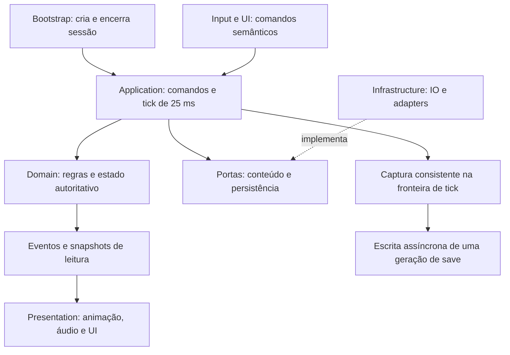

# Outrora — revisão de CTO, arquitetura e desenvolvimento de games

Data: 2 de novembro de 2026. Baseline principal auditada: `469aea8e7ea60e447b5691c9180c1ef9550b2da4`. Conferência final de alterações concorrentes: `ad03252` (nota de integração de agentes com Unity e link no README).

Natureza: revisão documental, com pesquisa técnica externa. As recomendações são propostas; não alteram decisões do responsável, a especificação recebida nem o status das stories.

Situação (2026-11-02): por decisão do responsável, R01–R05 foram incorporados à [arquitetura](../architecture/unity-offline-architecture.md) (seções 8, 9, 12 e 14), às stories [1.1a](../stories/1.1a-unity-foundation-and-sandbox.md) e [1.1b](../stories/1.1b-combat-ai-loot-vendor-and-save.md) e ao [sandbox](../architecture/sandbox-de-testes.md). R06 e as perguntas Q01–Q03 seguem para o fluxo de pergunta de volta da especificação; R07–R14 continuam como propostas.

## 1. Parecer

A direção arquitetural é adequada para iniciar um RPG local: processo único, domínio independente da engine, definições separadas de instâncias, simulação em passo fixo e sandbox usando as mesmas regras do jogo. Manteria essa base e a divisão em Story 1.1a e Story 1.1b.

O principal risco é implementar contratos ainda incompletos de determinismo, persistência, ordenação isométrica e streaming. Precisamos provar esses contratos com exemplos executáveis pequenos antes de multiplicar conteúdo. Identifiquei seis prioridades P1 e oito melhorias P2/P3. Todas se referem à preparação da implementação; não há incidente P0 demonstrado.

O projeto ainda não contém código Unity. Portanto, o parecer não aprova performance, estabilidade de save ou qualidade de código. A conclusão é: **base documental suficiente para iniciar a fundação, com ressalvas técnicas a incorporar aos contratos e testes da implementação**.

## 2. Evidências e limites

### Verificado no repositório

- Git e histórico de decisões presentes. A revisão incorporou a divisão das stories no commit `469aea8`, realizada em paralelo à leitura.
- README, PRD, arquitetura, sandbox, roadmap, ledger, dossiê, especificação e stories 1.1a/1.1b presentes.
- Ausentes: `Unity/`, scripts C#, `.asmdef`, scenes, `ProjectSettings`, manifest de pacotes, `.csproj` e suíte de testes executável.
- `packages/` vazio; nenhuma dependência instalada para auditar.
- `.gitignore` cobre os formatos do jogo de referência, mas ainda não os diretórios gerados pela Unity.
- Links Markdown locais existentes passaram pela verificação de existência após a divisão das stories.
- Integridade da especificação conferida: retirando os três campos de proveniência do conteúdo LF guardado no Git, SHA-256 `7711e74f04b261b47c85c74f83964fb38453c7ba66759bb67d1ff7f6df24183a`, igual ao registro de entrega.

O SDK `dotnet` está acessível. O Editor não foi localizado nos caminhos padrão consultados ou no PATH; isso não exclui instalação em outro caminho. Nenhum software foi instalado para a revisão.

### Fronteira de pesquisa

Regras T2A e formatos do jogo vieram exclusivamente da cópia local em `docs/spec/especificacao.md`. Não foram abertos código de emuladores/clientes, arquivos da instalação ou pesquisa do PRKing_REA. A pesquisa externa se concentrou na documentação oficial da Unity e Microsoft sobre engine e runtime, conforme o [registro de sala limpa](../spec/README.md).

### Prioridades e confiança

| Prioridade | Significado |
|---|---|
| P1 | Resolver antes de concluir o módulo afetado; pode invalidar estado, render ou testes |
| P2 | Incluir na fundação ou antes da expansão; reduz retrabalho e permite verificar resultados |
| P3 | Experimento posterior; não bloqueia o primeiro percurso jogável |

A existência das lacunas tem confiança alta por leitura direta. Seus efeitos em runtime são inferências de engenharia: ainda não há implementação para reproduzi-los. Os prazos deste relatório são gates de entrega, não promessas de calendário.

## 3. Decisões que recomendo preservar

| Decisão | Avaliação |
|---|---|
| Windows local, processo único e sem serviços obrigatórios | Coerente com o objetivo e com menor custo operacional |
| Unity 6.6 `6000.6.7f1`, escolhida pelo responsável | Preservar a baseline; testar qualquer upgrade |
| Passo de 25 ms e trabalho pesado em fatias de 10 Hz | Preservar A18, detalhando atraso e agendamento |
| Domínio C# puro e conteúdo por dados | Boa base para regras e testes independentes da apresentação |
| Conteúdo próprio padrão e leitor pessoal posterior | Manter sandbox funcional sem instalação externa |
| Estações e roteiros do sandbox | Boa estratégia para reproduzir gameplay rapidamente |
| IA simples primeiro, mundo vivo depois | Mantém o primeiro marco delimitado |
| DOTS/Entities condicionado a profiling | Manter: não existe gargalo medido que justifique a complexidade |

A Unity classifica a 6.6 como Supported Release até a próxima versão. Na documentação consultada em 02/11/2026, a 6000.7 aparece como Beta. A migração prevista deve passar por candidato validado e comparação de resultados. Fontes: [anúncio da 6.6](https://discussions.unity.com/t/unity-6-6-is-now-available/1735357), [manual da 6.6](https://docs.unity.com/en-us/engine/6000.6/manual/programming-environment/overview-of-dot-net-in-unity).

## 4. Achados prioritários

### R01 — P1: semente e comandos sem metadados não garantem replay

**Evidência:** arquitetura §12 promete recuperação com snapshot + semente + journal. Story 1.1a AC 8–9 e sandbox §2 exigem reprodução, mas não definem estado atual do RNG, tick/ordem dos comandos, versão das regras e ordem de resultados assíncronos.

**Impacto:** restaurar um snapshot intermediário reiniciando o RNG pela semente inicial repete o início da sequência, em vez de continuar do ponto salvo. Comandos iguais em ticks diferentes podem mudar combate e expiração de timers. A Microsoft também não garante sequências de `System.Random` entre grandes versões do .NET. [Microsoft: System.Random](https://learn.microsoft.com/en-us/dotnet/api/system.random?view=net-10.0#notes-to-callers)

**Proposta:** definir contador inteiro de ticks, sequência monotônica de comandos, algoritmo/versionamento do RNG e seu estado restaurável. Persistir versão da simulação e hashes do perfil e catálogo próprios. Separar RNG visual do RNG de regras. Ordenar entidades e empates de eventos de forma estável; conclusão de tarefas assíncronas não pode decidir gameplay por acaso.

O journal precisa conter tick de execução, sequência e parâmetros canônicos. Registrar comandos externos e de depuração uma vez; decisões determinísticas da IA podem ser regeneradas. Se registrar também decisões internas, o replay precisa impedir sua dupla execução. Registrar o tick final mesmo quando não há novos comandos.

**Aceite:** execução contínua, execução salva/carregada no meio e replay produzem o mesmo estado canônico e as próximas rolagens. A garantia vale na mesma versão de simulação; entre versões exige migração ou recusa explicada.

Owner sugerido: `@architect`/`@dev`. Gate: save e replay da Story 1.1a. Confiança alta na lacuna; efeito inferido.

### R02 — P1: atomicidade do arquivo não garante coerência do mundo salvo

**Evidência:** arquitetura §12 prevê manifest, snapshot, backup e journal separados, sem protocolo de captura, publicação da geração ou ordenação de saves concorrentes.

**Impacto:** serializar enquanto o mundo muda pode capturar item simultaneamente no chão e na mochila, ou ouro debitado sem mercadoria entregue. Um manifest também pode apontar para arquivos de outra geração. Checksum não detecta essas inconsistências lógicas.

**Proposta:** capturar DTO consistente numa fronteira de tick; serializar/comprimir essa cópia em background. Publicar uma geração completa e só então substituir o ponteiro/manifest. Guardar o último número de sequência do journal incluído no snapshot. Enfileirar pedidos para que um save antigo não termine por cima de um novo.

Salvar fora de `Assets/`, do repositório e da pasta do build. Usar o adapter de `Application.persistentDataPath`, mantendo empresa/produto estáveis ou migrando o caminho. [Unity: persistentDataPath](https://docs.unity3d.com/6000.0/ScriptReference/Application-persistentDataPath.html)

**Aceite:** injetar falhas em captura, escrita, troca e publicação; testar falta de espaço, journal parcial e dois saves consecutivos. Carregar uma geração inteira validada. Medir separadamente captura no frame e duração total do save.

Owner sugerido: `@dev`. Gate: save básico 1.1a e save com inventários 1.1b. Confiança alta na lacuna; efeito inferido.

### R03 — P1: batching por chunk pode contrariar a ordem isométrica

**Evidência:** arquitetura §8 exige a ordem da especificação §3.9, com personagens entre statics, e também agrupa terreno/statics e limita renderers por chunk sem explicar a intercalação.

**Impacto:** personagem à frente de parede quando deveria estar atrás; objetos de chunks vizinhos fora da ordem global. Otimização de renderer pode comprometer a imagem correta.

O manual distingue Chunk, que agrupa tiles e impede intercalar objetos entre profundidades, de Individual, que permite ordenar tiles e personagens juntos, com possível custo de desempenho. [Unity: Tilemap Renderer](https://docs.unity.com/en-us/engine/6000.0/manual/unity2d/tilemaps/reference/tilemap-renderer)

**Proposta:** separar chunk de armazenamento de unidade de renderização. Provar a ordem correta com terreno agrupado apenas onde seguro e objetos oclusores intercaláveis. Comparar Individual, SRP Batch quando aplicável e solução própria no cenário representativo. Preservar a ordem da especificação; não trocá-la por um eixo Y simples.

**Aceite:** galeria com árvore, parede, pilhas, elevação, telhado e fronteiras de chunks; personagem à frente e atrás. Picking escolhe o último objeto desenhado realmente coberto pelo cursor, respeitando transparência/recorte. Medir batching depois de passar nos casos visuais.

Owner sugerido: `@dev` de apresentação. Gate: `st.ren.desenho`, 1.1a. Confiança alta na tensão documental; defeito ainda não demonstrado em runtime.

### R04 — P1: falta uma política para atrasos do scheduler de 40 Hz

**Evidência:** arquitetura §9 define passo, fatias e fila limitada; não define máximo de passos por frame, tratamento do backlog, perda de foco nem fronteira de input.

**Impacto:** um frame lento provoca mais passos para recuperar tempo, aumentando carga. Descartar passos silenciosamente altera resultados e invalida o avanço do sandbox. A Unity documenta acúmulo de FixedUpdates em frames lentos. [Unity: Fixed updates](https://docs.unity3d.com/6000.0/Documentation/Manual/fixed-updates.html)

**Proposta:** tempo autoritativo em ticks inteiros, acumulador no adapter Unity e limite explícito de trabalho por frame. Definir pausa/desaceleração sob atraso; não saltar eventos vencidos. IA executa quando seu prazo vence: 40 Hz é resolução de agendamento, não obrigação de recalcular cada agente em cada passo. Input vira comando numa fronteira definida.

Avanço de N minutos deve executar os mesmos passos, em lotes com progresso/cancelamento consistente. Dez minutos a 40 Hz são 24.000 passos: executá-los num frame pode congelar o painel. Não usar `Time.timeScale` como substituto do relógio autoritativo.

**Aceite:** injetar frames de 100 e 250 ms; reproduzir a mesma sequência com apresentação em 30/60/144 FPS e comparar estado. Testar pausa, retomada e reset durante avanço de tempo.

Owner sugerido: `@dev`. Gate: relógio e painel 1.1a. Confiança alta na lacuna; efeito inferido.

### R05 — P1: sandbox precisa cobrir Play Mode sem domain reload

**Evidência:** arquitetura não define início/fim de sessão nem teste de entradas repetidas em Play Mode. A Unity 6.6 passou a recarregar apenas a Scene por padrão em projetos novos. [Unity 6.6: configuração de Play Mode](https://docs.unity.com/en-us/engine/6000.6/manual/programming-environment/code-reload-serialization/code-reload/code-reloading-editor/configurable-enter-play-mode)

**Impacto:** RNG estático, event bus, cache e inscrições residuais podem duplicar ações ou fazer testes passarem só na primeira execução. Isso pode parecer falha de determinismo.

**Proposta:** um objeto de sessão possui relógio, RNG, filas e mundo, com início e descarte explícitos. Assinaturas têm duração definida. ScriptableObjects de autoria geram dados de execução separados. Reset/disposal são idempotentes. Estáticos inevitáveis precisam de limpeza no lifecycle suportado pelo patch escolhido. [Unity 6.6: estado sem domain reload](https://docs.unity.com/en-us/engine/6000.6/manual/programming-environment/code-reload-serialization/code-reload/code-reloading-editor/domain-reloading)

**Aceite:** iniciar/encerrar dez sessões no mesmo Editor com o mesmo roteiro; uma reação por comando, nenhuma entidade antiga ou recurso retido. Repetir com domain reload ligado e desligado.

Owner sugerido: `@dev`. Gate: bootstrap/reset da 1.1a. Confiança alta no comportamento da engine; consequência para o jogo é inferida.

### R06 — P1 antes do leitor: IDs neutros não resolvem troca de geometria

**Evidência:** especificação §3.0 e arquitetura §7 prometem trocar origem sem quebrar save. As origens fornecem mapas independentes e o mapa próprio não pode copiar o de referência; falta migração de posições, regiões, spawns e containers entre geometrias.

**Impacto:** o save pode desserializar todos os IDs e colocar o personagem numa parede, água ou fora da região. Trocar sprite e trocar mapa navegável têm consequências diferentes.

**Proposta:** separar identidade do mundo, revisão da geometria e identidade visual. Aparência pode trocar com correspondência; geometria diferente exige mapeamento semântico explícito, validação de posições e política para entidades persistentes. Todo fallback deve ser determinístico e registrado.

Como compatibilidade é requisito da especificação, não retirar a promessa por decisão unilateral. Encaminhar a semântica exata ao fluxo de pergunta de volta antes do leitor. O sandbox autoral pode ser implementado independentemente.

**Aceite:** duas regiões sintéticas próprias, com IDs correspondentes e geometrias distintas; conferir personagem, caminhos, baús e spawns após troca. Resultado para migração não suportada precisa estar especificado.

Owner sugerido: `@architect`, via responsável pelo adendo. Gate: leitor da Fase 3. Confiança alta na lacuna; não é bug já observado.

## 5. Melhorias de fundação

### R07 — P2: explicitar composição e fronteiras dos assemblies

Arquitetura §2 liga a simulação ao Save Repository, enquanto §5 pede domínio sem infraestrutura. As referências também não dizem quem constrói os adapters concretos. A ambiguidade pode gerar ciclo de dependências.

Proposta: Domain guarda regras/estado; Application coordena comandos, ticks e portas; Infrastructure implementa IO/recursos; Presentation consome casos de uso; um pequeno Bootstrap compõe a sessão e conhece adapters. Domain não grava arquivos. Ativar `noEngineReferences` em Domain/Application e verificar o grafo de `.asmdef`. [Unity: assembly definition format](https://docs.unity3d.com/6000.0/Documentation/Manual/assembly-definition-file-format.html)

Compartilhar os mesmos fontes com testes .NET externos, sem cópias paralelas. Fixar linguagem/APIs compatíveis com o Editor; o manual 6.6 mantém .NET Standard 2.1 como perfil padrão. Um runner moderno não permite usar arbitrariamente APIs exclusivas dele no código do jogo. [Unity: API compatibility](https://docs.unity.com/en-us/engine/6000.6/manual/programming-environment/overview-of-dot-net-in-unity/dotnet-profile-support)

Owner/gate: `@architect`/`@dev`, assemblies da 1.1a. Aceite: mesmo domínio compila dentro/fora de Unity, sem dependências circulares.

### R08 — P2: definir propriedade de recursos e trabalho assíncrono

Arquitetura §8 prevê LRU/streaming, mas faltam dono dos handles, limites em bytes, cancelamento, descarte e proteção contra resultados de sessões antigas.

Proposta: carga pertence a uma geração da sessão; IO/CPU produzem dados desacoplados; objetos Unity são criados na thread apropriada. Uma tarefa antiga não pode povoar a sessão nova. Em Addressables, cada load explícito deve ter dono e release correspondente, inclusive em erro. [Unity: Addressables memory](https://docs.unity3d.com/Packages/com.unity.addressables@2.7/manual/memory-assets.html)

`async` não desloca CPU automaticamente. `Awaitable` oferece troca explícita de thread, e suas instâncias reaproveitadas não devem ser aguardadas múltiplas vezes. Mantê-lo nos adapters Unity. [Unity: Awaitable](https://docs.unity3d.com/6000.0/ScriptReference/Awaitable.html)

Owner/gate: `@dev`, contrato na 1.1a, stress na Fase 3. Aceite: alternar regiões e sair durante carga sem entidades tardias, handles perdidos ou memória ilimitada.

### R09 — P2: transformar performance em protocolo mensurável

PRD §7 e stories pedem 60 FPS, frame máximo de 33 ms e zero alocação recorrente relevante, sem hardware, duração, população ou estatística. Um frame de 33 ms já perde o alvo de 60 FPS. Não há medição hoje.

Proposta: registrar CPU/GPU/RAM, resolução, backend, build, VSync, warm-up e cenário. Medir p50/p95/p99 de frame/tick, pior frame, memória gerenciada/nativa/texturas, allocations por tick, draw calls, save e fila de paths. Medir Player Windows; Editor serve para investigação rápida. [Unity: coleta de performance](https://docs.unity.com/en-us/engine/6000.6/manual/analysis/profiler/profiling-applications)

Instrumentar adapters com `ProfilerMarker`: `Simulation.Step`, `Navigation`, `Chunk.Decode`, `Chunk.Commit`, `Save.Capture`, `UI.Refresh`. Não inserir `Unity.Profiling` no domínio puro: medir sua chamada na borda ou usar hook neutro. [Unity: ProfilerMarker](https://docs.unity3d.com/6000.0/ScriptReference/Unity.Profiling.ProfilerMarker.html)

Owner/gate: `@dev`/`@qa`, captura da 1.1a. Meta proposta, ainda não aceita: p95 do frame normal em até 16,67 ms no hardware-alvo; 33 ms separado para pico de streaming. Atualizar NFR só com revisão registrada.

### R10 — P2: preparar Git e builds repetíveis

O `.gitignore` cobre só dados de referência. Antes do primeiro commit Unity, acrescentar `Unity/Library/`, `Temp`, `Obj`, `Logs`, `UserSettings`, caches e builds gerados. Versionar conteúdo próprio em Assets com `.meta`, ProjectSettings, manifest e lockfile. Não ignorar `*.meta` ou `*.asset` genericamente.

`Packages/packages-lock.json` registra a resolução das dependências. [Unity: lock files](https://docs.unity.com/en-us/engine/6000.6/manual/packages-list/dependencies-lp/upm-conflicts-auto)

Adicionar normalização explícita em `.gitattributes` e merge de YAML quando aplicável, preservando a cópia recebida da especificação. Criar comandos locais para testes, validação e build, reutilizáveis depois em CI. Npm não é gate natural de um projeto Unity C# sem package.json. O runner oficial aceita execução em linha de comando e exportação de resultados. [Unity Test Framework: command line](https://docs.unity3d.com/Packages/com.unity.test-framework@1.4/manual/reference-command-line.html)

A versão da página de referência não é recomendação de pacote: selecionar a compatível com o projeto. Owner/gate: `@devops` para configuração, `@dev` para testes, primeiro commit Unity. Nenhum push, publicação ou workflow externo foi executado nesta revisão.

### R11 — P2: reset de estação precisa limpar timers e referências

Sandbox §2 prevê reset independente, mas relógio/RNG/journal são compartilhados. Apagar views pode deixar eventos agendados, alvos e callbacks antigos.

Proposta: propriedade de entidades por cenário, cancelamento dos timers/comandos desse cenário e geração por reset. Testes automáticos unitários começam com sessão isolada; integração compartilha mundo deliberadamente. Destruir view não destrói entidade autoritativa. Reset manual é comando registrado para replay.

Owner/gate: `@dev`/`@qa`, estações da 1.1a. Aceite: cem resets seguidos e avanço do tempo sem callbacks antigos. Resetar uma estação não reinicia o RNG global no meio do combate de outra.

### R12 — P2: fechar ambiguidades comportamentais pelo adendo

§5.4 limita ganho de skill ao total permitido; §5.5 prevê atrofia no cap. A ordem transacional precisa ser explícita. §6.1 fornece alcance para iniciar ataque; implementação/testes ainda precisam distinguir aquisição de alvo, alcance de contato e revalidação no impacto. Essas respostas devem vir do fluxo de especificação.

Proposta: matriz `seção → requisito → story → teste → profile`, com entradas/saídas nas fronteiras, unidade, arredondamento e empate. Usar representação exata para ouro e skills em décimos, sem alterar fórmulas silenciosamente.

Owner/gate: `@architect`/`@po`, via responsável pelo adendo, antes das fórmulas da 1.1b/Fase 2. Aceite: exemplos aprovados para cap e alcance. Não editar a cópia entregue.

### R13 — P2: testar controle e UI junto do primeiro percurso

Escala de UI está prevista, mas faltam foco, cancelamento de alvo, disputa UI/mundo pelo mouse e seleção consistente com desenho.

Proposta: feedback imediato de clique/alvo; interpolação visual sobre passos aceitos; preservar ritmo da simulação. Arrastar janela não deve disparar ataque no mundo. Layout é preferência separada do save autoritativo. Testar 720p/1080p/4K e escalas 75–200%.

UI Toolkit oferece binding de objetos C# em runtime: usar view models e invalidar campos alterados. Para journal/listas longas, `ListView` virtualizado e bind/unbind correto. [Unity: runtime binding](https://docs.unity.com/en-us/engine/6000.6/manual/uitoolkits/uielements/uie-data-binding/uie-runtime-binding), [Unity: ListView](https://docs.unity3d.com/6000.0/ScriptReference/UIElements.ListView.html).

Owner/gate: `@dev` de apresentação/`@qa`, menu 1.1a e inventário 1.1b. Aceite: seleção, drag, cancelamento e tooltip sem comandos duplicados ou reconstrução permanente da UI.

### R14 — P3: experimentar ferramentas recentes antes de criar equivalentes

- **Content Directories:** a 6.6 documenta builds de conteúdo local separados, carregamento granular e compatibilidade com Addressables. Comparar num experimento com assets próprios contra Addressables/AssetBundles locais: carga, memória e simplicidade. O provedor oculta a escolha. Isso não autoriza converter/cachear dados da instalação. [Unity 6.6: Content Directories](https://docs.unity.com/en-us/engine/6000.6/manual/assets-and-media/assets-managing-runtime/content-directories)
- **Build Analysis:** usar a janela nativa para investigar tamanho, etapas e assets antes de criar analisador próprio. [Unity 6.6: Build Analysis](https://docs.unity.com/en-us/engine/6000.6/manual/building-and-publishing/build-analyze-builds/build-analysis-window-reference)

São candidatos a experimento, não dependências novas aprovadas. Confirmar disponibilidade e funcionamento no patch `6000.6.7f1`: o manual online acompanha a linha da engine. Nenhum ganho percentual foi medido.

Owner/gate: `@dev`, integração de conteúdo próprio, sem bloquear o primeiro mapa pequeno.

## 6. Organização de execução proposta

Composição explícita basta no início. Container de injeção, event sourcing completo ou framework de behavior trees precisam reduzir trabalho demonstrado antes de entrar. Command bus pode ser uma fila tipada pequena; domínio puro não exige um framework genérico para RPGs.

Separar nos nomes e contratos: bloco de leitura, chunk de armazenamento, setor de ativação e grupo de renderização. Podem ter tamanhos diferentes. A especificação decide semântica; implementação escolhe armazenamento e apresentação que a respeitem.

## 7. Sequência para as próximas entregas

As stories mantêm seus critérios. Esta ordem organiza o trabalho dentro delas e acrescenta os gates técnicos propostos.

| Ordem | Entrega | Dono sugerido | Gate |
|---:|---|---|---|
| 1 | Contratos de tempo, RNG, comandos, snapshot e sessão; notas de decisão para escolhas difíceis de reverter | `@architect` | Exemplos de reload intermediário e replay definidos |
| 2 | Git, patch fixo, lockfiles, assemblies e runner local | `@dev`/`@devops` | Mesmo domínio compila dentro e fora da Unity |
| 3 | Bootstrap e mundo autoral mínimo | `@dev` | Dez entradas em Play Mode repetíveis |
| 4 | Movimento, picking e desenho entre quatro chunks | `@dev` | Correção visual/colisão antes de batching |
| 5 | Save básico, journal e avanço por lotes | `@dev` | Contínuo, reload e replay iguais |
| 6 | Fechar Story 1.1a | `@qa` | ACs e captura com hardware registrado |
| 7 | Containers, combate, criatura, loot e vendedor 1.1b | `@dev` | Fórmulas/transações testadas; sem perda/duplicação |
| 8 | Fechar Story 1.1b | `@qa` | Mover → combater → saquear → vender → salvar → carregar |
| 9 | Personagem e mundo maior; contrato de troca de origem antes do leitor | `@architect`/`@dev` | Migração de mundo/save testável na Fase 3 |

Não converto os pontos das stories em dias: não há histórico de throughput/equipe que sustente isso. Indicadores iniciais úteis: tempo até o primeiro build local repetível e taxa de roteiros do sandbox que continuam passando após mudanças.

## 8. Perguntas propostas para a especificação

Estas perguntas ficam nesta revisão para encaminhamento; nenhum adendo foi inventado ou aplicado.

| ID | Seção | Pergunta | Trabalho independente |
|---|---|---|---|
| Q01 | §3.0 e §15 | Troca de origem significa só identidade de itens/arte ou migração de entidades entre geometrias? Onde colocar uma posição inexistente? | Sandbox próprio e IDs |
| Q02 | §5.4–§5.5 | Atrofia ocorre antes do teste de capacidade do ganho no cap? Como selecionar a skill e tratar ganho parcial? | Fundação e skills fixas da 1.1b |
| Q03 | §6.1 e §13.1 | Qual alcance de contato e quando revalidá-lo no golpe corpo a corpo, distinto da aquisição de alvo? | Movimento, UI, galeria e scheduler |

R01–R05 são contratos técnicos que o próprio projeto pode detalhar preservando as regras aceitas. As perguntas acima passam pelo [registro de entrega](../spec/README.md), pois dizem respeito à interpretação do comportamento de referência.

## 9. Política recomendada para tecnologia

- Usar ferramentas Unity para input, UI, profiling e build; adicionar frameworks só por necessidade comprovada.
- Construir código próprio para regras, estado, grid, combate, timers e contratos de conteúdo.
- Manter configuração local de desenvolvimento com sandbox/ferramentas e configuração de verificação offline sem autoconexão de Profiler, depuração ou serviços opcionais. A restrição atual de não distribuir builds continua.
- Validar catálogo cedo: IDs duplicados, referências ausentes, ciclos de containers, pesos/capacidades inválidos, posições fora da região e parâmetros sem unidade.
- Medir allocations, reaproveitar buffers e limitar logs frequentes. Evitar pooling indiscriminado. [Unity: garbage collection practices](https://docs.unity3d.com/cn/2022.3/Manual/performance-garbage-collection-best-practices.html)
- Preservar conteúdo próprio e sala limpa. Esta revisão não reabre licença, marcas, distribuição ou interpretação jurídica.

### Nota sobre a pesquisa de integração de agentes acrescentada durante a revisão

Foi lida também a [pesquisa de integração com Unity](../research/2026-11-02-integracao-ia-unity.md), acrescentada em `ad03252`. Ela deve ser tratada como escolha de ferramenta de desenvolvimento, separada das dependências do jogo. Se for adotada uma ponte MCP, confiná-la ao Editor, fixar versão, testar os caminhos com espaços e confirmar por inspeção do build que ela não foi incluída no Player. Manter os comandos locais de teste/build utilizáveis sem a ponte.

Os preços, contagens de ferramentas, compatibilidades e a afirmação baseada em fonte secundária sobre o plugin Codex nessa nota não foram revalidados nesta revisão. Não são dependências aprovadas por este parecer. A seleção dessa integração não precisa bloquear a definição dos contratos de domínio da Story 1.1a.

## 10. Verificação realizada e próxima evidência necessária

Realizado: inventário, Git/status, leitura de arquitetura/escopo/stories, conferência das seções relevantes da especificação, integridade SHA-256, links locais e pesquisa oficial. A divisão de stories feita em paralelo foi preservada e incorporada à análise.

Ainda não aplicável: testes Unity, compilação C#, analyzers, build, FPS, memória e persistência em runtime. Não existe implementação executável; números simulados ou testes npm não comprovariam esses requisitos.

Esta entrega acrescenta apenas o relatório. As skills `cto-advisor` e `senior-architect` orientaram a priorização por impacto, os gates de evidência e a separação entre decisão aceita e recomendação. A próxima revisão deve examinar código e resultados da Story 1.1a, especialmente replay, reinício de sessão e render nas bordas de chunks.
